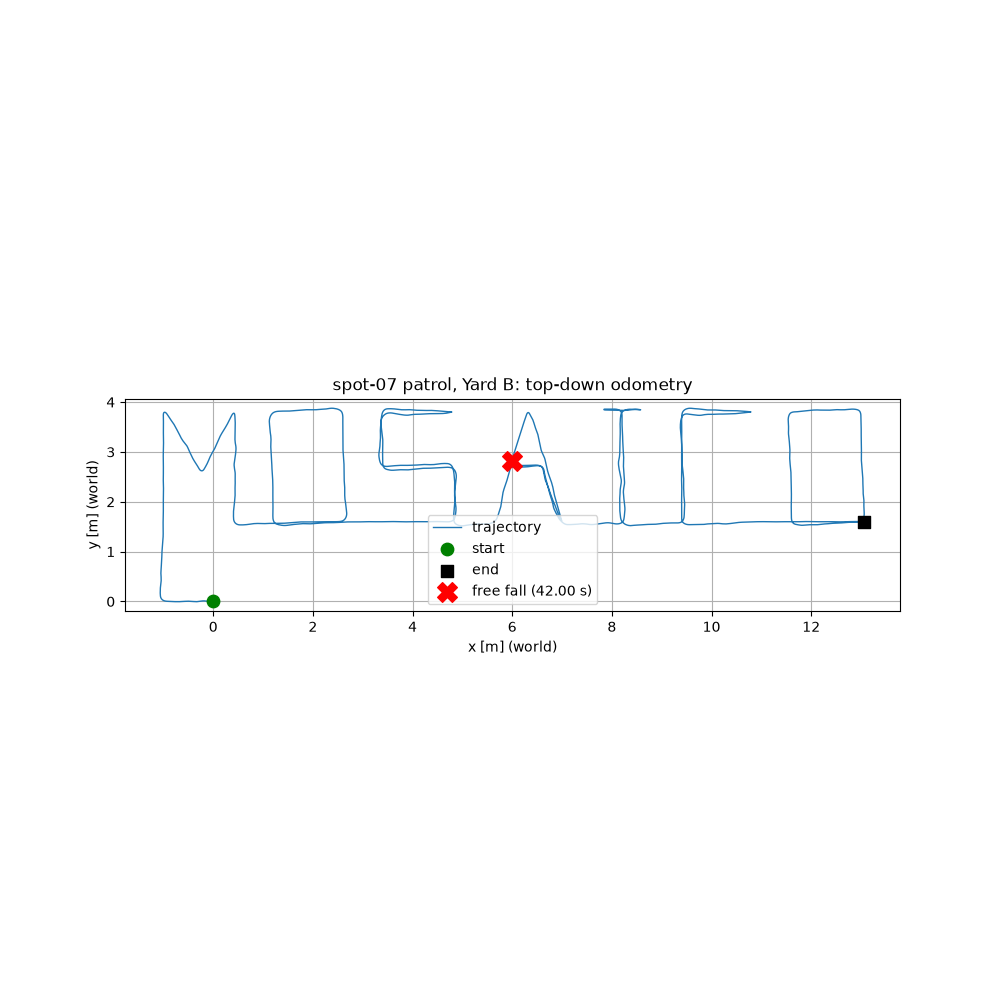
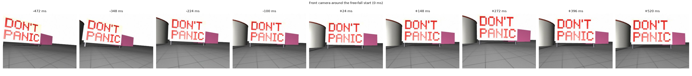
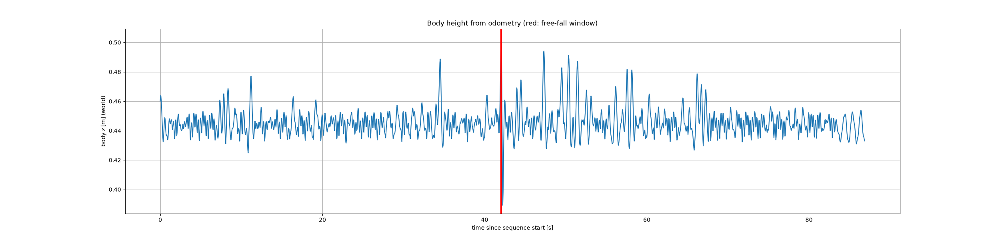

# Mission YB-42: finding spot-07's free fall with Mosaico

Solution to the Mosaico hackathon selection challenge ([CHALLENGE.md](CHALLENGE.md)).

## Answer

| | |
|---|---|
| Free-fall start | **`1795181862012000000` ns** |
| UTC | **2026-11-20T13:37:42.012Z** |
| Window end | `1795181862080000000` ns (68 ms, 17 IMU samples at 250 Hz) |
| Since recording start | 42.012 s |

The timestamp is the message `timestamp_ns` returned by the Mosaico query/clusterize (record time, clean 4 ms grid).
The IMU header stamps jitter by about ±0.35 ms around it.

## The query

```python
from mosaicolabs import MosaicoClient, IMU, Query, QuerySequence, QueryOntologyCatalog

thr = 5 * 0.03  # 5σ, σ = √0.0009 from the IMU acceleration covariance

with MosaicoClient.connect("localhost", 6726) as client:
    qresponse = client.query(query=Query(
        QuerySequence().with_name_match("spot_yb42"),
        QueryOntologyCatalog()
            .with_expression(IMU.Q.acceleration.x.between(-thr, thr))
            .with_expression(IMU.Q.acceleration.y.between(-thr, thr))
            .with_expression(IMU.Q.acceleration.z.between(-thr, thr)),
    ))
    for item in qresponse:
        # group matching samples into windows (gaps < 10 ms = 2.5 IMU samples are bridged)
        for topic, clusters in item.clusterize_all(override_clustering_dt_ns=10_000_000).items():
            print(topic, clusters)
# -> /imu/body [TopicCluster(id=0, timerange=TimestampRange(start=1795181862012000000, end=1795181862080000000))]
```

**Why all three axes:** an accelerometer measures specific force, so it reads about +9.81 m/s² on z at rest and about 0 on *every* axis in free fall, whatever its orientation.
A z-only condition would also match a robot that is tilted or lying on its side, where gravity shows up on x or y instead.

**Threshold:** ±5σ of the sensor noise stated in the IMU covariance (σ = 0.03 m/s²).
Walking produces swings of ±5 m/s², so nothing else in the recording matches.

**Caveat:** 68 ms of free fall corresponds to about 2.3 cm, while odometry shows the body dropping about 10 cm.
The threshold only captures the near-zero core of the fall, not the transitions into and out of it.
The reported start is the first sample that meets the condition.

## Bonus: what it saw and where it walked

- **Where:** a 67 m patrol whose top-down odometry trace spells **MOSAICO**. The fall happens on the "A", at world (x, y) = (6.00, 2.81) m, heading 71°, walking at about 0.87 m/s. The `world→body` transform in `/tf` matches odometry exactly.
  
- **What:** the front camera faces a **"DON'T PANIC"** sign. The frames tilt around the fall.
  
- **Mission log (`/robot/status`):**
  - 39.52 s: `WARN perception: unidentified object ahead (class: towel?)`
  - 43.8 s: `WARN imu: transient on /imu/body, logged for review`
  - 44.6 s: `recovered. don't panic.`

  So something did happen at 42 s.
- **Odometry height:** body z peaks at 0.495 m at the fall start, then drops to 0.389 m on impact.
  

## Reproduce

1. Start the server: `cd mosaico-srv && docker compose up -d`. This runs mosaicod, Postgres and the maintenance jobs, bound to 127.0.0.1:6726.
2. Install the client: `python3 -m venv .venv && .venv/bin/pip install -r requirements.txt`.
3. Ingest the recording. `spot_yb42.mcap` is provided by Mosaico and not included here.
   ```
   mosaicolabs.ros_injector spot_yb42.mcap --name spot_yb42 --metadata sequence_metadata.json
   ```
4. Run `python client_query.py`. It prints the window, writes the plots to `plots/` and writes the camera frames to `camera_frames/`.

| File | Contents |
|---|---|
| `client_query.py` | The query, clusterize, timestamp conversions, then calls the analysis |
| `client_df_parsing.py` | DataFrame extraction and plots for IMU, foot load cells, odometry, tf, mission log and camera frames |
| `client-smoke-test.py` | Connection check |
